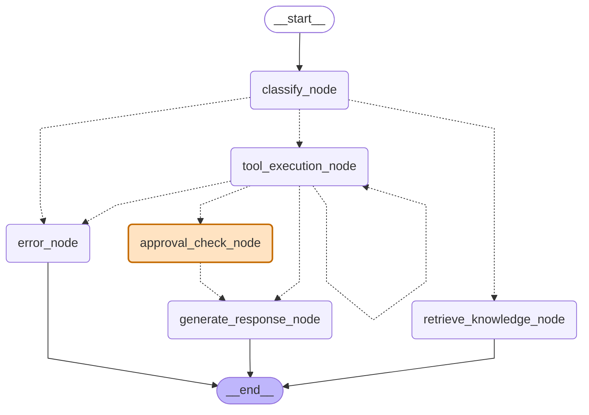
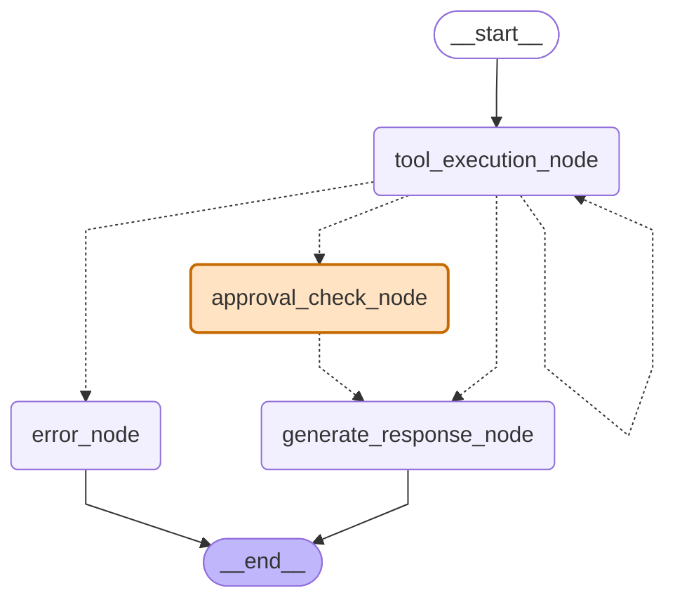

# SupportFlow LangGraph workflow

Generated from `app/graph.py` by `python scripts/export_graph.py`; do not edit by hand.

- Solid arrows always run; dashed arrows are conditional routes (`route_after_classify`, `route_after_tool`).
- Orange nodes pause the run with `interrupt()`. State is checkpointed in Postgres (thread = conversation), and an admin's approve/reject resumes it.

## Router mode (default, `ROUTING_MODE=router`)

A classifier labels the message and the router sends it to RAG or the tool loop.

## Hybrid mode (`ROUTING_MODE=hybrid`)

The router's graph, unchanged: pure policy questions still take the cheap RAG path. The difference is inside `tool_execution_node`, which also gets the read-only `search_policy` tool, so a question that needs an order and a rule can read both.

## Agent mode (`ROUTING_MODE=agent`)

No classify step: the tool loop has a read-only `search_policy` tool and decides whether to read policy, call order tools, or both.

